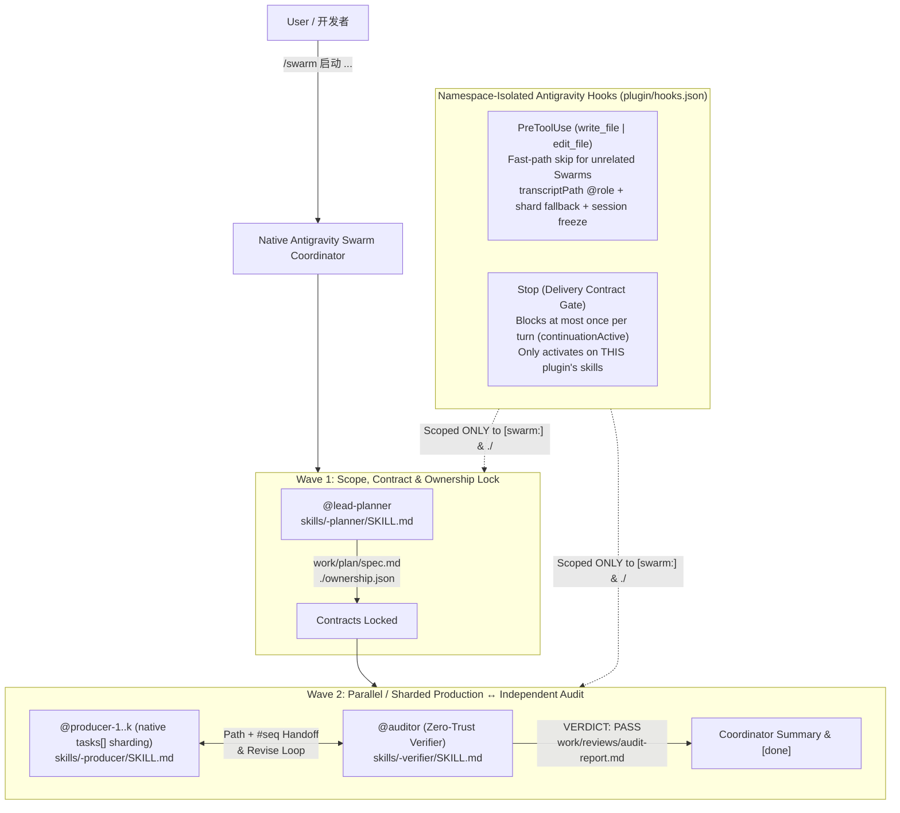

# Antigravity Swarm Template (`antigravity-swarm-template`)

> **Official-Spec Starter Template for Building Domain-Specific Multi-Agent `/swarm` Plugins on Google Antigravity 2.0**
>
> 面向 **Google Antigravity 2.0 原生 `/swarm` 协议** 的轻量级、零依赖、可开源多智能体插件初始模板。支持一键派生任意垂直领域 Swarm（科研调研、内容生产、金融分析、运营策略、法务审阅、工程研发等），内置**多 Swarm 共存隔离机制、声明式文件权属硬件锁、原生 `tasks` 分片支持与 `Stop` 交付门禁**。

[](https://github.com/cxbrucewayen/antigravity-swarm-template/actions/workflows/ci.yml)
[](./LICENSE)
[](https://nodejs.org/)
[](./ARCHITECTURE.md)

---

## Why This Template? / 为什么需要这个初始模板？

Antigravity 2.0 natively provides the **`/swarm` transport and orchestration primitives** (shared message board, `@mention` event wakeup, `swarm` tool `add`/`tasks`/`workspace`, Overview UI `plan.json`), **not** domain-specific team rosters, file write boundaries, or delivery checks.

When you build **multiple different Swarm plugins** on the same machine (for example, a coding swarm like [`antigravity-gstack-swarm`](https://github.com/cxbrucewayen/antigravity-gstack-swarm) alongside a research swarm and a content swarm), naive implementations quickly hit four traps:
1. **`rules/AGENTS.md` conflicts** — Every enabled plugin's `AGENTS.md` is always-on globally; unconditional `/swarm` takeover rules fight each other and burn the 20,000-token global rules budget.
2. **Global `hooks.json` cross-blocking** — Antigravity merges and executes all enabled plugins' hooks sequentially on every tool call; unscoped hooks block unrelated Swarms and slow down ordinary chats.
3. **Sharded worker role mismatch** — Antigravity's native `swarm{action:"add", name:"producer", tasks:[...]}` spawns `producer-1`, `producer-2`, ...; naive exact-name role maps miss sharded workers.
4. **Plugin manifest & hook schema gotchas** — Unknown top-level keys in `plugin.json` are silently dropped, `hooks.json` must sit at the plugin root (never `hooks/hooks.json`), and `Stop` hooks must respect `continuationActive` to avoid infinite loops.

**This template solves all four out of the box with zero external npm dependencies.**

---

## Architecture Overview / 核心架构



For the full design specification — including native `/swarm` protocol contracts, multi-swarm coexistence rules, and when to choose `/swarm` vs `run_workflow` — read [**ARCHITECTURE.md**](./ARCHITECTURE.md).

---

## Repository Layout / 目录结构

```text
antigravity-swarm-template/
├── plugin/                                 # Official Antigravity Plugin payload (zero external deps)
│   ├── plugin.json                         # Strictly official allowlisted fields
│   ├── hooks.json                          # Root-level lifecycle hooks (PreToolUse + Stop)
│   ├── mcp_config.example.json             # Optional plugin-prefixed MCP server template
│   ├── assets/logo.svg                     # 128x128 SVG logo with 10% safe margin
│   ├── rules/AGENTS.md                     # Minimal (<1 KB) domain-scoped routing rule (no frontmatter)
│   ├── hooks/
│   │   ├── lib-swarm-scope.mjs             # Scoped role detector, shard normalizer & ownership engine
│   │   ├── pre-tool-write.mjs              # Fast-path isolated write/edit guard
│   │   ├── stop-gate.mjs                   # Once-per-turn delivery contract verifier
│   │   └── swarm-lock-cli.mjs              # Self-contained session freeze & lock CLI
│   └── skills/
│       ├── my-swarm/                       # Orchestrator skill + brief-templates.md
│       ├── my-swarm-planner/               # Wave 1 planner role skill
│       ├── my-swarm-producer/              # Wave 2 parallel/sharded producer role skill
│       └── my-swarm-verifier/              # Zero-trust independent verifier role skill
├── scripts/
│   ├── scaffold.mjs                        # One-command generator for new domain Swarms
│   └── validate-plugin.mjs                 # Official Antigravity Plugin & Coexistence linter
├── examples/swarm-ownership.example.json   # Declarative role ownership example
├── tests/template-plugin.test.mjs          # Node built-in test suite (hooks, isolation, scaffold)
├── install.ps1 / install.sh                # Global (~/.gemini/config/plugins) OR workspace installer
├── uninstall.ps1 / uninstall.sh            # Clean uninstaller
└── ARCHITECTURE.md                         # Full protocol & multi-swarm coexistence blueprint
```

---

## Quick Start: Create Your Own Domain Swarm / 一分钟派生新领域 Swarm

### Option A: Generate a new repo from this template locally（本地一键派生）

```bash
npm run scaffold -- \
  --slug research-swarm \
  --title "Deep Research Swarm" \
  --domain "deep research, competitive intelligence, literature review" \
  --out ../antigravity-research-swarm
```

### Option B: Click GitHub **"Use this template"** and initialize in-place（GitHub 模板仓库克隆后原地初始化）

```bash
git clone https://github.com/<you>/<your-new-swarm>.git
cd <your-new-swarm>
npm run scaffold -- \
  --slug research-swarm \
  --title "Deep Research Swarm" \
  --domain "deep research, competitive intelligence" \
  --author <your-github-handle> \
  --repo https://github.com/<you>/<your-new-swarm> \
  --in-place
```

### Customize, Validate & Install / 定制、校验与安装

1. **Customize domain skills**:
   - Edit `plugin/skills/<slug>/SKILL.md` (roles, wave flow, workspace mode) and `references/brief-templates.md` (**keep `[swarm:<slug>]` on line 1**).
   - Fill in domain methodology inside `plugin/skills/<slug>-*/SKILL.md` (add or rename role skills freely).
   - Adjust `BUILT_IN_INVARIANTS` in `plugin/hooks/lib-swarm-scope.mjs` and `ROLE_CONTRACTS` in `plugin/hooks/stop-gate.mjs`.
   - *(Optional)* Rename `plugin/mcp_config.example.json` to `plugin/mcp_config.json` with `<slug>-` prefixed server names.
2. **Validate official spec & run tests**:
   ```bash
   npm run validate
   npm test
   ```
3. **Install into Antigravity 2.0** (global OR workspace-scoped):
   - **Windows (PowerShell)**:
     ```powershell
     # Global install (~/.gemini/config/plugins/<slug>)
     pwsh -ExecutionPolicy Bypass -File .\install.ps1

     # Or Workspace-scoped install (<project>/.agents/plugins/<slug>)
     pwsh -ExecutionPolicy Bypass -File .\install.ps1 -Workspace "C:\path\to\your-project"
     ```
   - **macOS / Linux**:
     ```bash
     # Global install (~/.gemini/config/plugins/<slug>)
     bash ./install.sh

     # Or Workspace-scoped install (<project>/.agents/plugins/<slug>)
     bash ./install.sh --workspace /path/to/your-project
     ```
4. **Launch in Antigravity**:
   Antigravity auto-discovers installed plugins on the next turn. Open any workspace and send:
   ```text
   /swarm 启动 <slug> 团队，帮我完成：【你的领域任务描述】
   ```

---

## License / 开源协议

Released under the [MIT License](./LICENSE).
